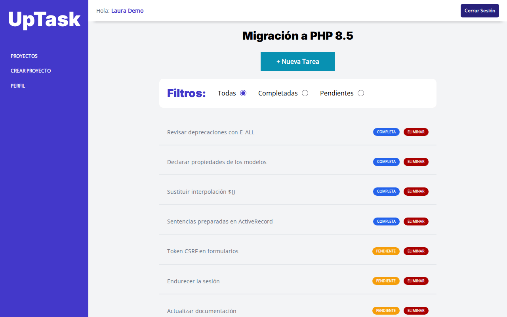
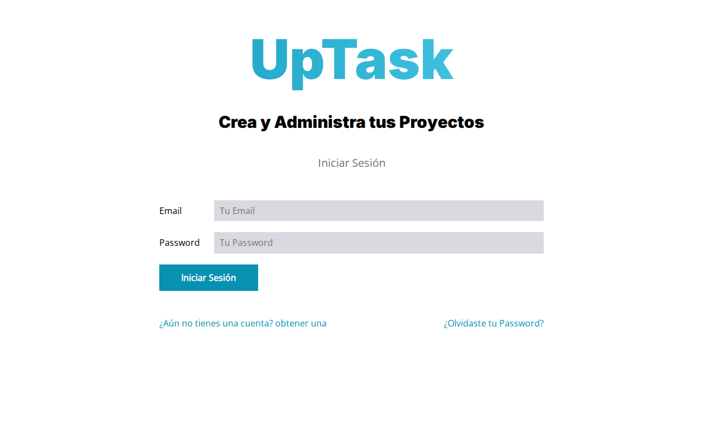
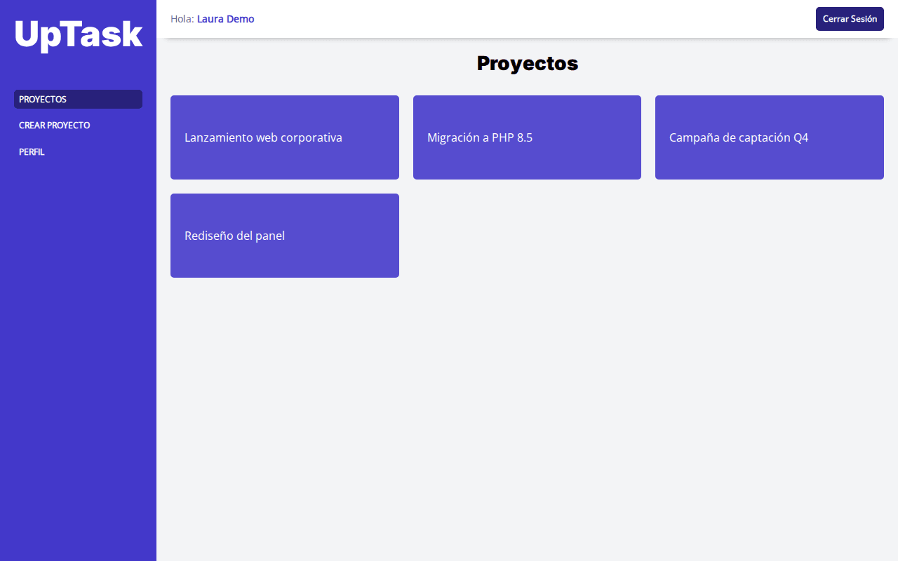
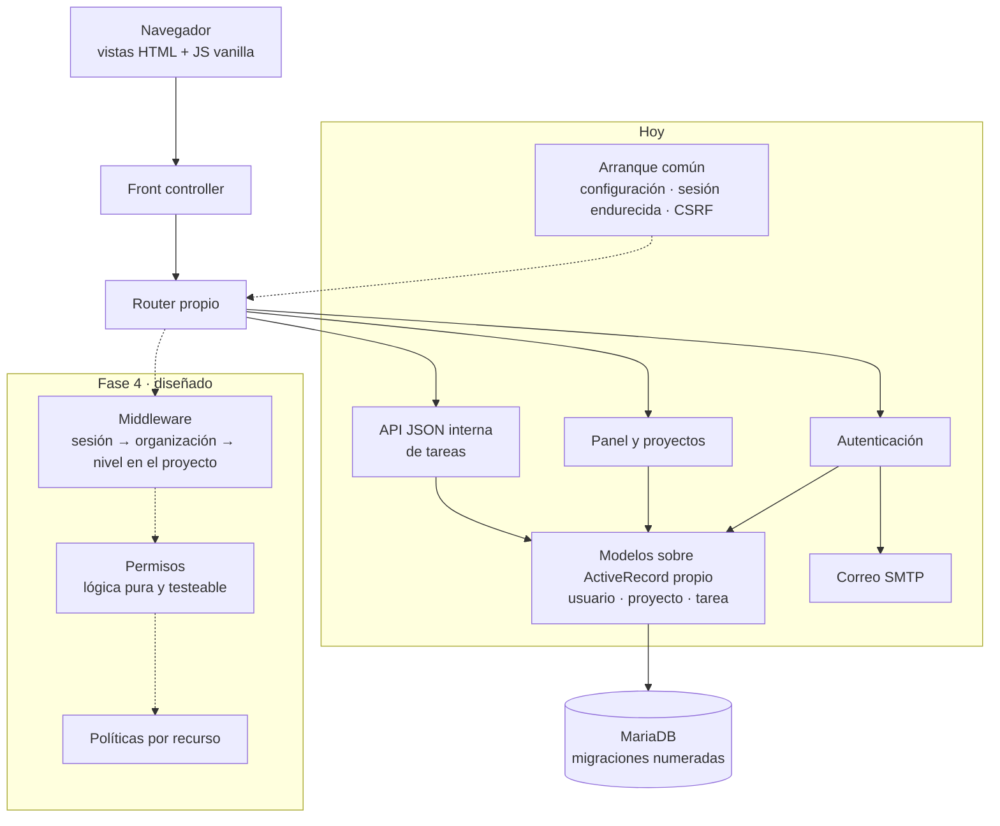

# UpTask rediseñado · Caso de estudio

**Rediseño en curso.** Gestor de proyectos y tareas que parte de un proyecto de formación y se está convirtiendo en un producto real: migrado a PHP 8.5, endurecido en seguridad y con un sistema de organizaciones y roles diseñado para la siguiente fase.

> Las capturas están hechas en local con **cuentas y proyectos ficticios**. La interfaz todavía es la del proyecto original: el cambio de identidad visual es una fase posterior del plan.

## Contexto y problema

UpTask nació como la aplicación de proyectos y tareas de un curso de desarrollo web. Al analizarla a fondo, el punto de partida era este:

- Estaba escrita para PHP 8.0 y daba muchas deprecaciones en versiones actuales.
- El alta estaba rota de origen: el correo de confirmación nunca llegaba al usuario.
- Tenía fallos de seguridad propios de un ejercicio, no de un producto que se pueda exponer.
- No se podían editar ni borrar proyectos, y una tarea era poco más que un booleano.

El rediseño consiste en convertir ese ejercicio en un **producto real**, por fases y con documentación verificada contra el código. El objetivo final es una herramienta multiusuario con organizaciones, equipos y roles por proyecto. Lo pausé para priorizar [Inmogestion](https://github.com/ricardo-mendez-saoprojects/inmogestion-case-study), que hereda de este proyecto el método de trabajo, la estrategia de migración y las decisiones de arquitectura.

## Mi papel

Diseño, desarrollo, despliegue y soporte: análisis del código heredado, plan por fases, decisiones de arquitectura registradas (ADR), implementación y verificación en ejecución.

## Funcionalidades

**Hechas (fases 0 a 2)**

- Registro con confirmación por correo de principio a fin, inicio y cierre de sesión, recuperación y cambio de contraseña, y edición del perfil.
- Proyectos propios: crear, listar y abrir.
- Tareas sin recargar la página: crear, renombrar, eliminar y alternar entre pendiente y completada, con filtro por estado.
- Aislamiento entre usuarios comprobado en servidor: cada persona solo ve y modifica lo suyo.
- Modo oscuro y menú lateral en móvil.

**Planificadas**

- **Fase 3 · producto monousuario completo:** editar y eliminar proyectos; tareas con descripción, prioridad, fecha límite y estados reales (pendiente, en progreso, completada); ordenar, filtrar y buscar; vista "Mis tareas" de todos los proyectos.
- **Fase 4 · organizaciones y roles:** varias organizaciones (multi-tenant), roles por proyecto, tareas asignadas y privadas, gestión de miembros y registro de actividad.
- **Fases 5 a 7:** identidad visual propia con contraste AA verificado, suscripciones, tests automatizados y lanzamiento.

| Inicio de sesión | Proyectos |
|---|---|
|  |  |

## Arquitectura

MVC propio en PHP, sin framework, por decisión de producto. El diagrama muestra lo que existe hoy y, en discontinuo, la capa de autorización diseñada para la fase 4.

## Sistema de roles y permisos (diseño de la fase 4)

> **Estado: diseñado y documentado, todavía no implementado.** Hoy la autorización es por propietario: cada usuario accede solo a sus proyectos y tareas, con la comprobación en servidor.

- **El rol no es de la persona, sino de su relación con cada espacio.** Alguien puede ser desarrollador en un proyecto y responsable en otro.
- **Dos niveles con herencia, donde gana el mayor:**
  - Organización: miembro, project manager y propietario.
  - Proyecto: lector, desarrollador y responsable.
  - El project manager hereda lectura sobre todos los proyectos y el propietario hereda el nivel de responsable.
- **"Modificar" se descompone en acciones:** editar y eliminar el contenido es cosa del autor; cambiar el estado, del autor, la persona asignada o el responsable; asignar, solo del responsable. Así el responsable gestiona sin reescribir el trabajo de otros.
- **Tareas privadas:** solo las ve su autor, ni siquiera el propietario de la organización.
- **Reglas no negociables:**
  - Toda consulta se filtra por organización.
  - La autorización va siempre en el servidor.
  - Se deniega por defecto.
  - Lo ajeno responde igual que lo inexistente, para no revelar que existe.

## Stack

- **Backend:** PHP 8.5 con MVC propio (router y ActiveRecord propios), sentencias preparadas y Composer.
- **Base de datos:** MariaDB con migraciones numeradas.
- **Frontend:** JavaScript vanilla con fetch/JSON, y Sass y esbuild mediante scripts de npm.
- **Correo:** SMTP, con Mailpit en local.

## Decisiones técnicas y retos resueltos

1. **Migración a PHP 8.5:** se declararon las propiedades de todos los modelos (ya no se pueden crear sobre la marcha), se eliminó la interpolación obsoleta y se hizo un barrido de deprecaciones de la 8.1 a la 8.5 recorriendo todas las rutas con `E_ALL`. Criterio de salida: log de errores en cero absoluto, y se cumplió.
2. **Orden de la migración:** primero se limpió el ruido de avisos y después se hizo el refactor arriesgado del ActiveRecord. Así, cada aviso nuevo era una señal y no ruido.
3. **Sentencias preparadas con lista blanca de columnas.** Efecto lateral: la base empezó a devolver enteros en vez de texto, y el JavaScript tuvo que normalizar los tipos en la frontera.
4. **Seguridad:** escapado de toda la salida (también en el cliente), CSRF en todos los formularios y llamadas que escriben, sesión endurecida con regeneración al iniciar sesión y cierre de sesión real, autorización por propietario en servidor, credenciales fuera del código y redirecciones que cortan la ejecución. Cada arreglo se probó con el ataque antes y se verificó después.
5. **API JSON interna:** salida aislada para que ningún aviso de PHP corrompa la respuesta, `Content-Type` correcto y un único contrato de respuesta para éxito y error.
6. **Migraciones versionadas:** el esquema inicial se dedujo del código y se validó ejecutándolo. A partir de ahí, solo migraciones numeradas que se aplican antes que el código.
7. **ADR de assets:** se sustituyó Gulp por Sass y esbuild, de unas quince dependencias de desarrollo a dos, compatibles con Node moderno.
8. **ADR de entorno:** MariaDB también en local para igualar el motor de producción, todo en minúsculas por la diferencia de mayúsculas entre sistemas de ficheros, y colación explícita.
9. **La documentación como contrato:** cada afirmación lleva su evidencia en el código, y lo no comprobado se marca como tal.

## Estado y roadmap

| Fase | Estado |
|---|---|
| 0 · Entorno | Hecha |
| 1 · Análisis documentado | Hecha (agosto de 2026) |
| 2 · PHP 8.5 y seguridad | Hecha en su rama (agosto de 2026), pendiente de cerrar e integrar |
| 3 · Producto monousuario completo | Planificada |
| 4 · Organizaciones y roles | Diseñada |
| 5 a 7 · Marca, suscripciones, tests y lanzamiento | Planificadas |

**En pausa** desde septiembre de 2026 para priorizar Inmogestion. Se retoma cerrando la fase 2.

---

> **Código privado** (proyecto de cliente / en producción). Disponible para revisión en entrevista bajo petición.

<strong>English</strong>

# UpTask redesign · Case study

**Redesign in progress.** A project and task manager that started as a training project and is being turned into a real product: migrated to PHP 8.5, hardened for security, and with an organizations-and-roles system designed for the next phase.

> Screenshots were taken locally with **fictitious accounts and projects**. The UI is still the original one: the visual rebrand is a later phase of the plan.

## Context and problem

UpTask started as the project and task app of a web development course. A thorough review showed this starting point:

- It was written for PHP 8.0 and threw many deprecations on current versions.
- Sign-up was broken from the start: the confirmation email never reached the user.
- It had the security flaws of an exercise, not of a product that can be exposed.
- Projects could not be edited or deleted, and a task was little more than a boolean.

The redesign turns that exercise into a **real product**, in phases and with documentation checked against the code. The end goal is a multi-user tool with organizations, teams and per-project roles. I paused it to prioritise [Inmogestion](https://github.com/ricardo-mendez-saoprojects/inmogestion-case-study), which inherits this project's working method, migration strategy and architecture decisions.

## My role

Design, development, deployment and support: legacy code analysis, a phased plan, architecture decision records (ADRs), implementation and runtime verification.

## Features

**Done (phases 0 to 2):** sign-up with end-to-end email confirmation, login and real logout, password recovery and change, profile editing; own projects (create, list, open); tasks without page reloads (create, rename, delete, toggle pending/completed, filter by status); user isolation enforced on the server; dark mode and mobile sidebar.

**Planned:**

- **Phase 3 · complete single-user product:** edit and delete projects; tasks with description, priority, due date and real statuses (pending, in progress, completed); sorting, filtering and search; a "My tasks" view across projects.
- **Phase 4 · organizations and roles:** multi-tenant organizations, per-project roles, assigned and private tasks, member management and an activity log.
- **Phases 5 to 7:** own visual identity with verified AA contrast, subscriptions, automated tests and launch.

## Architecture

Custom PHP MVC, no framework, as a product decision. See the Mermaid diagram above: front controller → custom router → authentication, projects and an internal JSON tasks API → models on a custom ActiveRecord → MariaDB. The dashed part is the phase 4 authorization layer: middleware (session → organization → project level), a pure and testable permissions class, and per-resource policies.

## Roles and permissions (phase 4 design)

> **Status: designed and documented, not implemented yet.** Today authorization is ownership-based: each user can only access their own projects and tasks, checked on the server.

- **A role belongs to a person's relationship with each space, not to the person.** Someone can be a developer in one project and a lead in another.
- **Two inheriting levels, where the higher one wins:**
  - Organization: member, project manager and owner.
  - Project: viewer, developer and lead.
  - The project manager inherits read access to every project, and the owner inherits lead.
- **"Modify" is split into actions:** editing and deleting content belongs to the author; changing status to the author, the assignee or the lead; assigning only to the lead. Leads manage work without rewriting other people's.
- **Private tasks:** visible only to their author, not even to the organization owner.
- **Non-negotiable rules:**
  - Every query is scoped by organization.
  - Authorization always happens on the server.
  - Access is denied by default.
  - Someone else's resources respond exactly like non-existent ones, so their existence is not revealed.

## Stack

PHP 8.5 (custom MVC: own router and ActiveRecord, prepared statements, Composer) · MariaDB with numbered migrations · vanilla JavaScript with fetch/JSON, Sass and esbuild through npm scripts · SMTP mail, Mailpit locally.

## Technical decisions and challenges

1. **Migration to PHP 8.5:** declared properties in every model (they can no longer be created on the fly), removal of deprecated interpolation, and a deprecation sweep from 8.1 to 8.5 across every route with `E_ALL`. Exit criterion: an absolutely empty error log, which was met.
2. **Migration order:** the warning noise was cleaned first and the risky ActiveRecord refactor came second, so every new warning was a signal and not noise.
3. **Prepared statements with a column allowlist.** Side effect: the database started returning integers instead of strings, so the JavaScript had to normalise types at the boundary.
4. **Security:** escaping of all output (client side too), CSRF on every write form and call, hardened sessions with regeneration on login and real logout, server-side ownership checks, credentials out of the code, and redirects that stop execution. Each fix was tested with the attack before and verified after.
5. **Internal JSON API:** isolated output so no PHP warning can corrupt a response, the correct `Content-Type`, and a single response contract for success and error.
6. **Versioned migrations:** the initial schema was inferred from the code and validated by running it. From then on, only numbered migrations, applied before the code.
7. **Assets ADR:** Gulp replaced by Sass and esbuild, from about fifteen dev dependencies to two, compatible with modern Node.
8. **Environment ADR:** MariaDB locally too, to match the production engine; lowercase identifiers everywhere because file systems differ in case sensitivity; explicit collation.
9. **Documentation as a contract:** every claim carries its evidence in the code, and anything not checked is marked as such.

## Status and roadmap

Phases 0 and 1 done; phase 2 (PHP 8.5 and security) done on its branch, pending wrap-up and merge; phase 3 planned; phase 4 designed; phases 5 to 7 planned. **Paused** since September 2026 to prioritise Inmogestion; work resumes by closing phase 2.

---

> **Private code** (client project / in production). Available for review in an interview on request.

